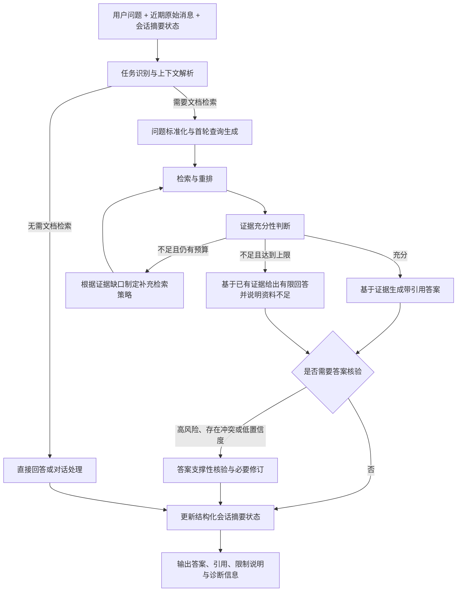

# Agentic-ChemRAG 架构

## 文档定位与阶段决议

本文档是 Agentic-ChemRAG 的架构基线文档。自 2026-05-24 起，本阶段确定采用 **C：自适应混合检索架构**，即以低成本快速路径处理证据充分的简单问题，在证据不足、问题复杂或风险较高时按条件升级为多轮检索、答案核验和会话状态维护。

在用户明确要求修改架构前，后续需求设计、代码实现、接口调整、测试建设和性能优化均应以本架构为依据。局部实现可以分阶段落地，但不得将固定单轮检索或无约束的全量 ReAct 循环作为新的默认方向。

本文档区分两类内容：

- **当前实现**：代码仓库中已经可运行的能力，用于说明迁移起点。
- **阶段目标架构**：后续开发应逐步达到的规范行为，是设计评审和验收依据。

除代码标识符、协议字段、命令及第三方技术名外，项目架构与设计文档默认使用中文编写。

### 已冻结决策（2026-05-24）

以下决策已由用户确认，在架构未重新讨论并明确修改前保持有效：

| 决策项 | 冻结结论 | 实现约束 |
| --- | --- | --- |
| 检索预算 | 简单事实问题目标为单轮；复杂或高风险问题最多三轮 | 循环上限由程序控制，模型不得自行无限追加检索 |
| 高风险范围 | 安全、危害、毒性、实验条件建议、合成路线建议和放大操作均视为高风险 | 此类回答必须触发答案核验，核验失败时最多执行一次受控修订 |
| 模型分配 | 第一阶段沿用现有模型；provider 接口预留后续按节点分配便宜模型或强模型的能力 | 当前不因架构迁移新增模型部署变量，先取得评测数据 |
| 第一批实现范围 | 定义状态/节点契约，升级结构化证据充分性判断，并将限制说明输出给用户 | 不在第一批引入多轮循环、任务重写、答案核验循环或持久会话摘要 |
| 第二批实现范围 | 接入程序控制的最多三轮补充检索闭环，以资料缺口生成规则式补充查询 | 不引入答案核验或会话摘要；后续已升级为可选混合补充检索策略 |
| 第三批实现范围 | 建立自适应检索的质量、成本与时延评测基线，记录评估轮次及可追踪模型调用 | 不新增任务路由、风险识别、LLM 查询重写、答案核验或会话摘要节点 |
| 第四批实现范围 | 落地任务预算、任务感知证据评估、后续轮次增量重排和显式评测预热 | 仍不引入答案核验或会话摘要；高风险识别仅作为后续核验入口 |
| 第五批实现范围 | 接入条件触发的答案级核验与一次受控修订 | 核验器只检查最终答案，不自由生成新答案；修订仍只能使用 `verified_evidence` |

## 目标与原则

系统面向化学与材料科学文献问答，提供 PDF 上传、解析与索引、文档范围检索、基于证据的回答、页码引用和关联图片展示能力。

阶段目标架构遵循以下原则：

- **证据优先**：回答必须基于检索证据；资料不足时明确说明缺口，不补造结论。
- **按需升级**：简单问题优先走一次检索的快速路径，仅在必要时增加检索轮次与模型调用。
- **职责解耦**：路由、问题重写、检索、证据判断、回答、核验和会话状态更新各自承担明确职责。
- **状态结构化**：节点之间传递可验证的结构化状态，而不是依赖不可审计的自由文本推理历史。
- **成本可控**：多轮检索具有轮次上限、超时和可观测指标；不能无限循环调用工具。
- **风险分级**：化学安全、危害、实验条件和决策建议等高风险回答必须提高证据要求，并按条件触发核验。
- **便于扩展与测试**：新增检索器、解析器、记忆存储或核验策略时，应通过稳定接口接入，且每个模块具备可重复验证手段。

## 模块边界

- `backend/app/main.py` 只装配 FastAPI 应用、中间件、路由、数据库生命周期和启动预热，不承载具体接口业务。
- `backend/app/database.py` 管理数据库引擎创建与模式准备；同一准备函数可由应用启动和部署脚本复用。
- `backend/app/api/dependencies.py` 统一管理依赖注入；读取 FastAPI 托管的 repository，复用对象存储和 provider，并按请求构建带可变诊断状态的检索服务与 graph。
- `backend/app/api/routers/documents.py` 提供上传、批量上传和文档列表接口。
- `backend/app/api/routers/chat.py` 提供问答编排、作用域解析和引用响应映射。
- `backend/app/api/routers/assets.py` 提供 PDF 与图片资产读取接口。
- `backend/app/api/routers/maintenance.py` 提供存活检查、完整问答能力 readiness、任务状态和索引维护接口。
- `domain` 维护纯数据结构，不依赖基础设施。
- `parsing` 维护 PDF 解析与切块策略。
- `providers` 维护 LLM、嵌入和重排适配器。
- `repositories` 维护持久化实现。
- `services` 组合业务用例，其中 `DocumentService` 隔离上传去重与索引排队逻辑，检索服务封装召回与重排能力，`ReadinessService` 独立汇总关键依赖探测状态。
- `agents` 维护 LangGraph 状态、节点与条件流转。
- `tasks` 维护 Celery 集成。

依赖方向：

```text
FastAPI 路由 -> 注入的服务/仓储 -> provider/仓储/对象存储
LangGraph 节点 -> 检索服务/provider/会话状态接口
domain -> 不依赖项目基础设施
```

新增的会话状态存储、证据核验器或检索策略生成器应以接口或 provider 形式接入，不得将持久化、外部调用和工作流控制混在同一节点中。

## 依赖生命周期

FastAPI `lifespan` 在接收请求前建立数据库引擎、执行 `prepare_database()` 并将单个 `PgVectorRepository` 存放在 `app.state` 中；请求依赖只读取该对象。停止应用时统一释放引擎，因此接口请求既不创建连接池，也不执行模式升级。

部署流水线也可执行 `scripts/prepare_database.py`，使用相同的准备函数先行升级数据库。Celery 任务与离线脚本只按工作需要创建数据访问对象，不隐式改变数据库结构。

对象存储客户端、embedding/LLM/reranker provider 与 `QueryRouter` 通过缓存依赖复用，从而避免在每个 HTTP 请求中重复初始化客户端或模型。

健康状态区分两种语义：`/api/health` 是低成本存活检查，只回答 API 进程能否响应；`/api/ready` 是完整问答能力检查，会探测 PostgreSQL、对象存储、任务后端、本地 embedding/reranker 与外部 LLM。仅所有已配置的必要组件可用时 readiness 返回 `ready`；LLM 或重排器不可用而系统仍可保守回退时返回 `degraded` 和 HTTP `503`，避免部署层把降级实例误认为完整问答能力在线。

`RetrievalService` 与 `MultiAgentRagGraph` 按请求创建，因为检索服务保存本次请求的 `last_*_diagnostics`；如果全局复用，会使并发请求相互覆盖观测数据。后续引入检索轮次、证据缺口和核验诊断后，同样应保持单次请求状态隔离。

## 当前实现：迁移起点

当前已实现的文档索引与问答链路如下：

```text
PDF 上传
  -> DocumentService 以 owner_id=demo 注册文档，并按 file_hash 去重
  -> Celery ingest_document 任务
  -> PyMuPDFParser 提取页面文字和图片
  -> ObjectImageStore 保存与页面关联的图片资产
  -> ParentChildChunker 创建用于检索的子切块
  -> embedding provider 生成向量
  -> PgVectorRepository 保存文档、图片、切块与向量
  -> /api/chat 调用按请求创建的 MultiAgentRagGraph
  -> 规划器 Planner -> 任务分类器 TaskClassifier -> 预算策略 BudgetPolicy
  -> 检索器 Retriever -> 证据评估器 EvidenceAssessor
  -> 检索控制器 RetrievalController
     -> 证据不足且仍有预算：补充检索策略选择器 + QueryRefiner -> Retriever
     -> 充分或停止：回答器 Answerer
  -> 回答器 Answerer -> 图片选择器 ImageSelector
  -> 前端展示答案、引用与资产
```

当前工作流已在第二批将证据判断节点内部命名明确为 `evidence_assessor`：它调用 LLM 输出 `EvidenceAssessment`，记录证据覆盖项、资料缺口、冲突、支撑片段、下一步检索目标与观察性置信度。为兼容已存在的 API 消费方，诊断响应仍使用 `diagnostics.verifier` 字段名。

第四批已使 `TaskDecision` 进入实际流程：`TaskClassifier` 使用稳定规则识别简单事实、图片查询、文档总结、跨文档筛选、多条件及高风险问题，`BudgetPolicy` 将简单事实和明显越界问题限制为一轮，将图片/总结问题限制为两轮，仅为多条件、跨文档与高风险问题保留最多三轮预算。第五批开始，高风险分类同时作为答案级核验的强制触发条件。

图片查询与文档画像查询已具备第一阶段轻路径：`figure_index` 会进入专用 figure 索引召回，`document_profile` 会进入文档画像召回且默认跳过重排；两类 route 在回答阶段使用确定性摘要函数，不调用通用答案生成 LLM。该轻路径仍未完全覆盖编排层，当前仍会经过 `evidence_assessor` 做证据充分性判断，补充检索策略也仍复用通用 `RetrievalStrategySelector`。因此后续优化重点不是“从零设计轻路径”，而是将证据评估、补充检索策略和成本诊断进一步按图片/画像任务收窄。

当证据不足且仍有预算时，`retrieval_controller` 会触发补充检索策略层。该层先将运行状态归一化为 `RetrievalPolicyContext`，再由 `RetrievalStrategySelector` 在 `rule`、`llm`、`hybrid` 与 `safety_conservative` 之间选择；当前路由节点给出的 `route` 不会在该阶段被改写。每轮新证据按 `(document_id, chunk_id)` 累计去重，证据评估始终基于原始用户问题与累计证据执行。第四批开始，评估 prompt 同时接收任务类型、风险等级、轮次预算和任务特定充分标准，要求模型不得自行扩大用户要求范围；例如图片查询找到直接相关图题即可，文档总结不额外要求作者或期刊元数据。

后续轮次的检索在重排前排除已经进入累计证据的候选，仅对新增候选执行重排，并通过 `new_candidate_count`、`excluded_existing_count` 与 `incremental_only` 诊断记录节省范围。该策略以证据覆盖判断而非全局严格排名作为循环依据，降低重复推理成本；若未来排序质量出现下降，再评估是否需要周期性全局重排。

只有被最终评估确认为充分支撑的片段会交给 `Answerer` 与引用映射。API 和界面输出 `limitations`，使资料缺口对用户可见。当达到停止条件但证据仍不足时，当前实现返回保守提示，不生成基于部分证据的推断型答案；当评估调用超时或返回格式无效时，会保留非空候选用于诊断和人工复核，但不将其写入 `verified_evidence` 或授权生成结论性回答，并通过限制说明、`diagnostics.verifier.fallback_used` 与警告信息暴露回退状态。

答案级核验位于 `Answerer` 之后、`ImageSelector` 之前，由 `AnswerVerificationPolicy` 按风险、冲突、低置信度、多步骤、跨文档和强断言等条件触发。`answer_verifier` 只检查最终答案中的关键断言是否被 `verified_evidence` 支撑、是否遗漏资料限制、是否存在引用错误或过度表述；它不允许自由生成新答案。核验失败且存在修订指令时，`answer_reviser` 最多执行一次受控修订，修订仍只能使用原问题、已验证证据、资料限制和核验器给出的修订要求。

第三批补充了不改变决策流程的观测层；第五批后观测范围扩展为答案核验路径，并补齐图片选择诊断：`diagnostics.assessment_rounds` 逐轮保留证据评估输入规模、结论、缺口与时延；`diagnostics.answer_verification` 记录触发原因、通过状态、未支撑断言数、遗漏限制数、引用错误数、过度表述数、是否需要/已执行修订；`diagnostics.image_selection` 记录选图策略、候选数、命中数、是否使用 LLM 与是否回退；`diagnostics.llm_call_counts` 依据节点的 `used_llm` 路径标记，统计证据评估、答案生成、答案核验、答案修订和图片选择这五类可追踪模型阶段调用，用于架构成本比较而非供应商账单核算。

为避免模拟回答污染检索循环评价，离线质量基线采用可组合 provider：允许用 `fake` 生成低成本占位答案，但证据充分性判断默认交由已配置真实模型执行；只有显式请求确定性回归时，才允许证据评估也使用 `fake`。因此，是否触发第二/第三轮检索应由真实证据判断反映，而不是由“非空候选即充分”的测试实现决定。

当前实现尚未具备以下目标能力：

- 根据任务和会话状态进行完整的问题消歧与检索查询重写。
- 维护面向连续对话的结构化摘要状态。
- 在资料仅部分覆盖问题时生成按结论区分证据与缺口的有限答案。
- 对答案核验失败后的修订结果进行第二次 claim check；当前实现仅做一次受控修订。

以上能力应按照本文档的阶段目标架构逐步补齐，而不是把当前固定流程视为最终形态。

已落地的代码契约位于 `backend/app/domain/rag.py`，包含 `TaskDecision`、`QueryPlan`、`EvidenceAssessment`、`AnswerVerification` 与检索停止原因约束。目前 `TaskDecision`、`QueryPlan`、`EvidenceAssessment` 和 `AnswerVerification` 均已进入运行流程。

## 阶段目标架构：自适应混合检索工作流

### 总体流程



### 快速路径与升级路径

系统不对每个问题默认执行完整 ReAct 循环，而采用条件升级策略：

| 场景 | 默认检索轮次上限 | 答案核验 | 会话状态更新 |
| --- | ---: | --- | --- |
| 简单事实查询且首轮证据充分 | 1 | 默认不触发 | 有上下文价值时更新 |
| 指代追问或需要消歧的问题 | 2 | 条件触发 | 更新 |
| 对比、归纳、多条件分析问题 | 3 | 低置信度或冲突时触发 | 更新 |
| 合成建议、实验条件、安全性或危害问题 | 3 | 必须触发 | 更新 |
| 达到上限仍缺资料的问题 | 3 | 视输出风险触发 | 记录未解决问题 |

检索轮次上限默认设置为 `3`，表示最大预算，而不是每次请求必须执行三轮。后续可通过配置调整，但必须保留硬上限和诊断记录。

## 节点职责与契约

| 节点 | 核心职责 | 主要输入 | 主要输出 |
| --- | --- | --- | --- |
| 上下文解析与任务路由 | 判断是否检索、任务类型、指代对象和风险等级 | 原始问题、近期消息、会话摘要 | `task_type`、`requires_retrieval`、`risk_level`、解析后的实体 |
| 问题标准化与查询生成 | 保留原问题，生成明确问题与可检索查询 | 路由结果、实体、原始问题 | `resolved_question`、`search_queries` |
| 检索与重排 | 按查询和文档范围获取候选证据，保留来源 | 查询、作用域、检索策略 | `evidence`、`accumulated_evidence`、检索诊断 |
| 证据充分性判断 | 判断覆盖情况、缺失方面、冲突和下一轮目标 | 问题、候选证据、轮次 | `evidence_assessment`、已验证证据 |
| 补充检索策略生成 | 只针对缺口改写查询或拆分子问题 | 缺失方面、冲突、既有查询 | 新查询与检索策略 |
| 回答生成 | 仅使用已验证证据回答并映射引用 | 解析后问题、已验证证据 | `answer`、`citations`、限制说明 |
| 答案核验 | 检查关键结论是否被引用支撑及是否遗漏限制 | 答案、引用、证据评估 | 核验结果、修订请求 |
| 会话状态更新 | 保存可用于后续消歧的摘要，不替代证据 | 当前轮问题、回答、未解决项 | 新的结构化会话状态 |

节点实现必须保持单一职责。例如，证据充分性判断节点可以提出下一轮检索目标，但不应直接执行数据库检索；状态更新节点可以保存“尚缺少高温稳定性证据”，但不应将推断内容保存为已确认事实。

## 任务类型与路由策略

任务路由至少支持以下类型，后续允许通过注册式策略扩展：

| 任务类型 | 示例 | 默认策略 |
| --- | --- | --- |
| `fact_lookup` 事实查询 | “该化合物的熔点是多少？” | 单轮检索优先，充分则快速回答 |
| `context_followup` 上下文追问 | “那它在水中稳定吗？” | 先消解实体，再检索 |
| `comparison` 对比分析 | “材料 A 与 B 哪个更适合此条件？” | 拆分覆盖项，允许补充检索 |
| `synthesis_or_experiment` 合成或实验建议 | “如何设计这条反应路线？” | 多证据检索并强制核验 |
| `safety_or_risk` 安全与风险判断 | “该试剂在此条件下是否危险？” | 高证据门槛、强制核验及限制说明 |
| `conversation_only` 对话处理 | “总结刚才讨论的结论。” | 优先基于状态和近期消息，不强制检索 |

问题重写不能覆盖原问题。每一次检索都应保留原始问题、解析后问题和实际查询，以支持问题追溯、质量评估和错误定位。

## 共享状态设计

工作流使用结构化状态传递数据。当前 `RagGraphState` 应逐步扩展以承载以下概念字段；具体类型实现可按 Python 数据模型拆分，避免单个字典不断膨胀：

```python
class AgentState:
    # 请求与上下文
    original_question: str
    resolved_question: str
    recent_messages: list[dict]
    conversation_summary: dict | None
    document_ids: list[str] | None
    scope: str | None

    # 路由与风险控制
    task_type: str
    requires_retrieval: bool
    risk_level: str
    route: str

    # 自适应检索
    query_plans: list[QueryPlan]
    current_query: str
    retrieval_round: int
    max_retrieval_rounds: int
    evidence: list
    accumulated_evidence: list
    verified_evidence: list
    evidence_assessment: EvidenceAssessment
    assessment_history: list[dict]
    stop_reason: str | None

    # 回答、引用与核验
    answer: str
    citations: list[dict]
    limitations: list[str]
    verification_result: dict | None

    # 可观测性与状态更新
    llm_call_counts: dict[str, int]
    diagnostics: dict[str, object]
    warnings: list[str]
    memory_update: dict | None
```

状态字段应满足以下约束：

- `original_question` 永远保留用户原始表达，不允许被重写覆盖。
- `retrieval_round` 与 `max_retrieval_rounds` 控制循环退出，达到上限后必须进入回答或保守拒答路径。
- `evidence` 表示本轮候选，`accumulated_evidence` 按文档与切块去重保存所有轮次候选；`verified_evidence` 仅包含可用于回答和引用的证据。
- `stop_reason` 必须说明检索为何结束，当前支持充分、达到上限、无新查询、无新证据、评估回退和无检索方向。
- `limitations` 必须进入最终输出，不能只记录在内部诊断中。
- `assessment_history` 保存每一次证据充分性判断的结果，不能只保留最后一轮而丢失追加检索的原因。
- `llm_call_counts` 只统计节点路径已标记使用 LLM 的阶段，当前包含 `evidence_assessment`、`answer_generation`、`answer_verification`、`answer_revision` 与 `image_selection`；它不代表供应商实际计费请求数，无法判断的 provider 内部行为必须保持未计入并在文档中说明。
- `diagnostics` 保存时延、模型调用、检索轮次、回退与核验结果，不承载业务事实。

## 会话历史与上下文注入

多轮会话分为两套独立能力，避免展示历史和推理上下文互相污染：

| 能力 | 存储位置 | 主要用途 | 内容边界 |
| --- | --- | --- | --- |
| 完整对话历史 | `chat_sessions`、`chat_messages` | 前端展示、刷新恢复、会话切换 | 保存用户与助手文本、引用、图片、资料限制和少量诊断摘要；不保存工具调用过程 |
| 注入上下文 | `chat_contexts` | 供 LangGraph 解析追问、指代和限定条件 | 保存确定性压缩后的上下文，不替代本轮检索证据 |

`/api/chat` 接收 `session_id`。如果请求未携带会话 ID，后端创建新会话；如果携带已有会话 ID，后端读取 `chat_contexts` 并写入 `RagGraphState.conversation_context`。当前注入点包括路由、任务分类、首轮检索 query、补充检索 query、证据评估、答案生成和图片选择。注入文本只用于解析“它”“该材料”“上述条件”等上下文，不允许绕过 `verified_evidence` 直接生成结论。

上下文压缩采用确定性策略，不调用 LLM：

```text
最近 N 轮：保留完整 user / assistant 文本
更早历史：按轮次结构化截取
超过字符阈值：从最早压缩轮次开始丢弃，最后保留最近完整上下文
```

默认保留最近 3 轮完整文本，总注入上下文上限为 8000 字符。较早轮次压缩时保留用户问题前 160 字、助手结论前 240 字，并尽量保留论文结构化信息：文档范围、相关文档、章节、页码、`chunk_id`、图片 caption 和资料限制。完整 `chat_messages` 永不压缩，前端分页或切换会话时读取完整记录。

## 查询重写与补充检索

首轮问题标准化输出建议采用以下结构：

```json
{
  "original_question": "那它在水里的稳定性怎么样？",
  "resolved_question": "催化剂 X 在水溶液中的稳定性如何？",
  "search_queries": [
    "催化剂 X 水溶液 稳定性",
    "catalyst X aqueous stability hydrolysis"
  ]
}
```

首轮未覆盖关键问题时，后续查询必须根据缺口产生，允许使用以下策略：

- 同义词、英文名、化学式、CAS 号或材料别名扩展。
- 将包含多个结论要求的问题拆解为独立子问题。
- 面向缺失条件检索，例如温度、溶剂、循环寿命或失活机制。
- 对相互冲突的结论开展验证性检索，而不是直接选择其中一个结果。

系统应记录每轮查询、触发原因、结果数量、证据评分和停止原因，用于后续成本与效果评估。

当前补充查询已从单一规则拼接升级为混合策略。`RuleQueryRefiner` 保留原有“原始问题、`next_search_goal`、`missing_aspects` 与 `conflicts`”的低成本路径；`LlmQueryRefiner` 只生成结构化检索 query，不生成答案，并受 scope、任务类型和安全模式约束；`HybridQueryRefiner` 在复杂任务、高风险任务、弱召回或规则无收益时优先追求质量，LLM 不可用时回退到规则路径。若第二轮及之后未返回新的去重证据，系统仍直接停止而不再次调用证据评估模型；若返回候选包含旧片段，旧片段在重排前即被过滤。

## 证据充分性与回答规范

证据判断不能仅返回“能回答/不能回答”，目标输出至少应覆盖以下内容：

```json
{
  "sufficient": false,
  "covered_aspects": ["常温水相稳定性"],
  "missing_aspects": ["高温水相稳定性", "连续运行寿命"],
  "conflicts": [],
  "next_search_goal": "检索高温水相条件下的降解与失活证据",
  "confidence": 0.42
}
```

充分性判断应检查：

- 用户问题中的关键子项是否均有直接证据覆盖。
- 每项关键结论是否具备可映射到文档与页码的证据。
- 文献之间是否存在冲突，或结论是否仅来自间接推断。
- 问题是否属于需要更严格证据标准的风险类型。

回答输出应清晰区分：

- 有文献直接支撑的结论。
- 基于证据但仍属于推断的说明。
- 检索未覆盖或目前无法确认的资料缺口。
- 支撑关键结论的引用来源。

达到最大检索轮次仍不充分时，系统允许基于已有证据回答已覆盖部分，但必须显式说明无法回答的部分以及资料不足原因。

## 答案核验策略

答案核验不是所有请求的默认步骤，以下情况必须或应当触发：

- `safety_or_risk` 或 `synthesis_or_experiment` 等可能影响实验决策的任务必须触发。
- 证据评估存在冲突、关键内容主要依赖推断或总体置信度低时应触发。
- 回答包含多个独立结论，且引用映射复杂时应触发。

核验节点检查范围包括：

```json
{
  "citation_support": "每个关键结论是否有对应证据支持",
  "relevance": "引用是否真正回答对应结论",
  "unsupported_claims": [],
  "missing_disclosures": [],
  "pass": true
}
```

核验节点不应脱离证据自由重写答案；若核验不通过，应输出问题和修订要求，由回答生成节点依据证据完成一次受控修订。

## 会话摘要状态

会话状态用于提升追问理解、指代解析和路由质量，不用于替代文档证据。推荐状态结构如下：

```json
{
  "current_topic": "催化剂 X 在水相连续反应中的稳定性",
  "entities": [
    {
      "name": "催化剂 X",
      "aliases": ["X catalyst"],
      "role": "当前讨论对象"
    }
  ],
  "user_goal": "判断是否适合连续反应",
  "confirmed_findings": [
    {
      "statement": "已找到常温水相稳定性信息",
      "citation_ids": ["citation-1"]
    }
  ],
  "unresolved_questions": ["高温条件稳定性", "长期失活数据"],
  "last_turn_summary": "用户进一步询问连续反应适用性"
}
```

状态管理约束如下：

- 路由和问题解析默认使用“最近一到三轮原始消息 + 结构化摘要”，不以摘要完全替代近期原始上下文。
- `confirmed_findings` 必须能够追溯到引用；无来源推断不得沉淀为确认事实。
- 新证据推翻旧结论或用户切换主题时，应更新或失效相关摘要项。
- 会话状态存储接口应与 LangGraph 节点解耦，以便后续替换内存、数据库或外部存储实现。

## 可观测性、成本与性能控制

为比较质量、成本和时延，诊断信息至少应记录：

| 指标 | 用途 |
| --- | --- |
| `task_type`、`risk_level`、`selected_route` | 分析路由是否合理 |
| 每轮 `search_queries` 与 `retrieval_round` | 分析查询重写与循环行为 |
| 候选与已验证证据数量 | 衡量召回及验证过滤效果 |
| `covered_aspects`、`missing_aspects`、`conflicts` | 解释继续检索或停止的原因 |
| 检索、重排、判断、生成、核验和总时延 | 识别性能瓶颈 |
| LLM 调用次数、回退标志、核验触发原因 | 估算费用并排查异常 |
| 引用数量与限制说明数量 | 监测有依据回答和保守输出行为 |
| `new_candidate_count`、`excluded_existing_count`、`incremental_only` | 衡量后续轮次增量重排节省 |
| embedding、路由与 reranker 预热时延 | 将冷启动成本与单案例时延分离 |

当前已实现 `retrieval_rounds`、`assessment_rounds`、`answer_verification`、`image_selection`、`stop_reason` 与 `llm_call_counts` 的 API/离线报告透传。评测样例可标注 `task_category`、`risk_level`、`expected_aspects`、`required_disclosures`、`expected_retrieval_behavior` 与 `max_acceptable_rounds`，据此统计首轮成功、重试触发、观察到的重试成功、无收益重试、限制披露覆盖、答案核验触发/修订情况、图片选择模型调用及已追踪 LLM 调用均值。“观察到的重试成功”表示本次多轮运行最终答成，并非严格的单轮反事实因果收益。

成本控制的默认规则：

- 简单事实查询及明显超范围问题最多执行一轮检索，证据不足时直接保守输出。
- 图片查询和单文档总结默认最多执行两轮检索。
- 多条件、跨文档和高风险问题最多执行三轮检索，达到预算后必须终止循环。
- 后续轮次只对新增候选执行重排，旧证据仍保留给累计覆盖判断使用。
- 答案核验按风险和证据情况触发，不对所有低风险快速路径增加固定开销。
- 会话状态仅保存紧凑结构化摘要与引用关联，不累积完整模型推理文本。

## 测试与评估基线

每个新增或修改的模块必须配套测试。自适应混合架构落地时，至少覆盖以下验证范围：

| 模块或行为 | 必须验证的内容 | 推荐手段 |
| --- | --- | --- |
| 路由与风险分类 | 各任务类型、无需检索路径、高风险分类 | 路由单元测试与黄金案例 |
| 问题解析与查询重写 | 原问题不丢失、实体消歧、查询策略可追踪 | provider 假实现与结构化输出测试 |
| 单轮快速路径 | 证据充分时不发生额外检索 | graph 单元测试，断言调用次数 |
| 多轮补充检索 | 缺口驱动的新查询、策略选择、最多三轮退出 | graph 条件边测试、策略选择单元测试与模拟检索器 |
| 任务预算策略 | 简单事实一轮、多条件/高风险三轮 | `TaskClassifier` 与 `BudgetPolicy` 单元测试 |
| 增量重排 | 第二轮排除已见候选且诊断正确 | `RetrievalService` 固定仓储测试 |
| 证据判断 | 覆盖项、缺失项、冲突项和回退策略 | LLM provider 单元测试 |
| 回答与引用 | 仅引用已验证证据，资料不足明示 | API 集成测试 |
| 答案核验 | 触发条件、修订路径、未支撑断言检测 | 节点测试与高风险案例 |
| 会话摘要状态 | 指代解析、来源追溯、状态失效更新 | 多轮会话测试 |
| 成本和时延 | 轮次、模型调用数、阶段时延可见 | 诊断字段与离线评估报告 |

评测集应包含事实查询、上下文追问、多条件检索、对比分析、资料不足、冲突资料以及安全/风险问题，并对比固定单轮流程、全量循环流程和本架构的自适应流程。关键指标包括答案正确性、引用支撑率、问题覆盖完整性、不确定性表达质量、平均检索轮次、平均 LLM 调用次数、平均响应时延、无效追加检索率和错误摘要影响率。

当前已有的可执行验证命令见 [测试与启动验证指南](./TESTING.md)。文档架构变更本身不代表对应功能已经实现；新增节点进入代码后，必须同步补充测试与该指南中的验证说明。

## 实施顺序

本阶段按以下顺序演进，避免一次性引入过多未验证复杂度：

1. **已完成第一批**：定义状态/节点契约，扩展证据充分性结果为覆盖项、缺失项、冲突项和下一轮目标，并向用户输出资料限制。
2. **已完成第二批**：引入规则式补充查询与按条件触发的检索循环，累计证据并记录轮次与停止原因，检索预算最多三轮。
3. **已完成第三批**：扩展离线评测契约与中文报告，记录证据评估轮次、停止原因、重试行为、资料限制披露和可追踪 LLM 调用成本；支持以假回答配合真实证据评估运行质量基线。现有样例为可扩展的基线种子集，仍需结合人工核对继续补充复杂与高风险案例。
4. **已完成第四批**：引入规则式任务分类与预算策略，按任务约束证据评估范围，后续轮次只重排新增候选；离线报告分开记录 embedding、路由和重排预热，节点级测试可独立验证输入输出。
5. **已完成第五批**：增加条件触发的答案核验与受控修订路径，优先覆盖高风险、冲突、低置信度、多步骤、跨文档和强断言回答；核验失败时最多修订一次。
6. **下一轮优先事项**：补齐图片查询与文档画像查询的第二阶段轻路径，在已具备专用召回、画像跳过重排和确定性回答的基础上，评估是否可对低风险高置信结果跳过或简化 LLM 证据评估，并为 figure/profile 任务提供更窄的补充检索策略。
7. 后续基于 `retrieval_strategy`、`query_refinement` 与 `answer_verification` 诊断对比规则、LLM 与混合补充检索/核验的质量收益、额外成本、时延和安全表现，尤其要单独统计 figure/profile route 的轮次、重排、评估调用与命中质量。
8. 引入可追溯引用的结构化会话摘要状态，用于追问与指代解析。

任何偏离上述方向的大范围改动，应先更新本架构文档并获得用户确认。

## 扩展点

- 将固定的 `demo` owner 替换为认证后的租户/用户依赖，无需改动各路由业务。
- 增加 RAGFlow/MinerU 等解析适配器，处理更复杂的 PDF。
- 通过统一检索接口扩展关键词检索、外部资料源或化学专用数据库，并保留来源标识。
- 引入更强的证据验证器、答案核验器和手工标注的评估案例。
- 将 parent context 扩展与精确 child evidence 一并返回。
- 通过可替换的会话状态存储实现跨会话追问能力，同时保持证据追溯约束。
