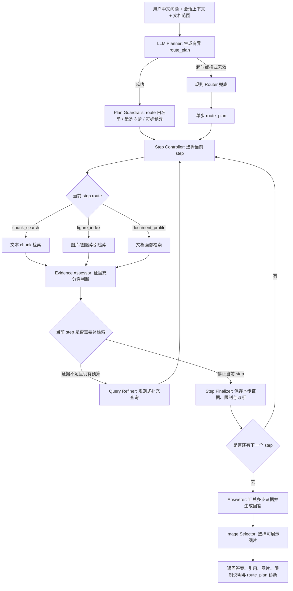

# Route Plan 架构图

本阶段将原来的“单 route 路由”升级为“有界 route_plan 执行”。LLM Planner 默认负责理解中文问题和会话上下文，规则 Router 作为超时、格式错误或不可用时的兜底。旧的单路由问题会被规范化为只有一个 step 的计划，因此兼容现有 `chunk_search`、`figure_index` 与 `document_profile` 链路。

## 关键约束

- `route_plan.steps` 最多 3 步，避免模型制造无界工具循环。
- 每个 step 只能使用白名单 route：`chunk_search`、`figure_index`、`document_profile`。
- 单步问题保持旧行为：`route_plan.steps` 长度为 1。
- 同一个 step 内仍保留原有“检索 -> 证据评估 -> 补检索”的循环。
- 跨 step 的证据会在 `Step Finalizer` 汇总，最终由 `Answerer` 统一输出。
- 规则 Router 只作为 fallback，不再作为中文复杂问题的默认理解入口。

